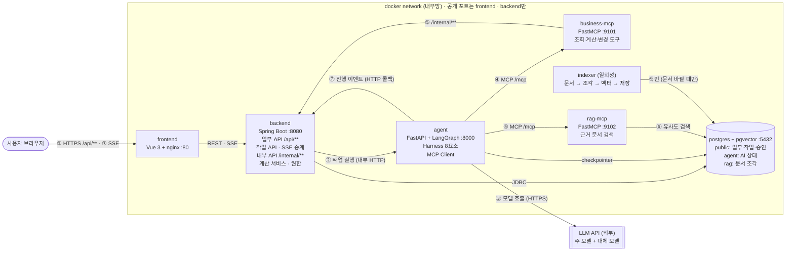
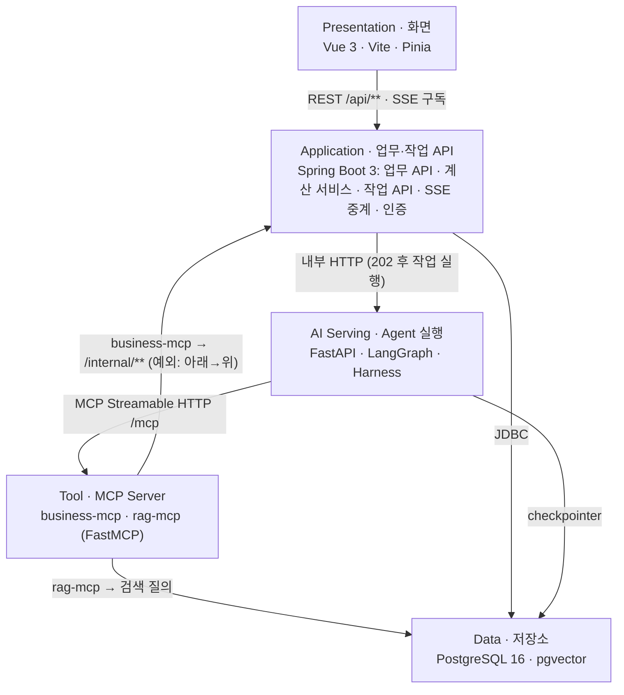
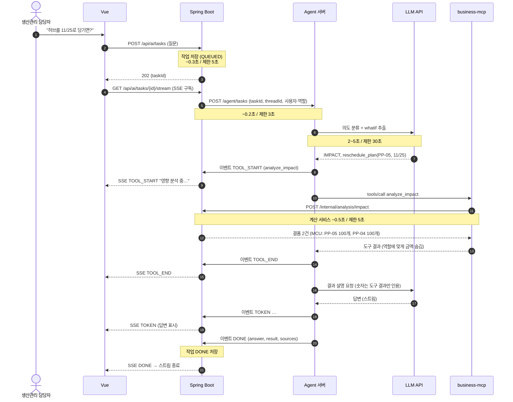
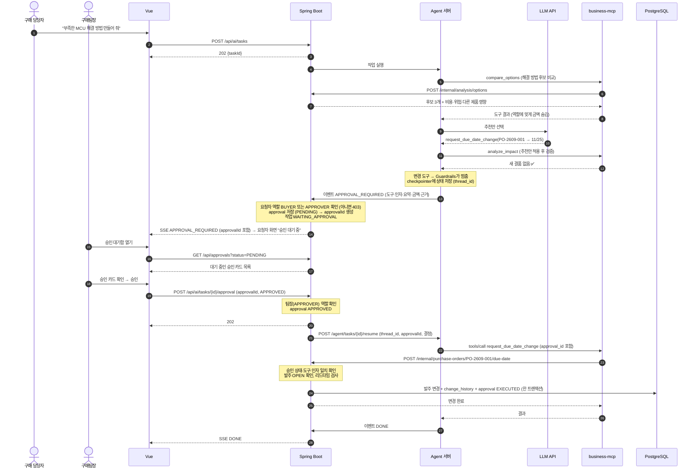
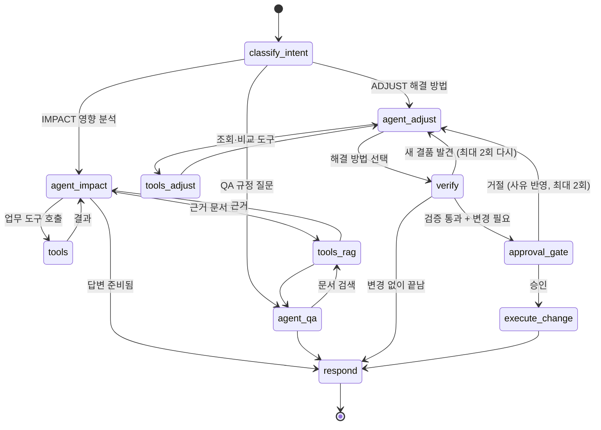
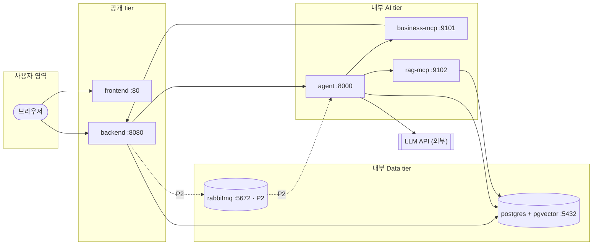
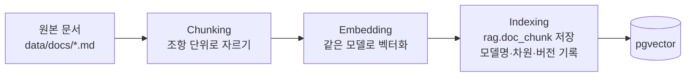

# BOM Agent 아키텍처

> **작성일**: 2026-10-19 · **수정일**: 2026-10-20 · **상태**: 초안 v0.3 (10/20 오전 스크럼 반영) · **관련 문서**: [결정 기록](decisions.md), [Walking Skeleton 근거](walking-skeleton.md), BOM Agent PRD, BOM Agent DB 스키마, 기획안(A1~A3)
>
> **기준**: 교재 5장 레퍼런스 아키텍처, 6장 Harness
>
> **표기**: **확정**은 기획안·PRD에서 합의한 내용, **추천안**은 팀 결정이 남은 내용 (B·C·D·E 안건)

---

## 0. 이 문서를 읽는 법

그림 한 장으로 모든 질문에 답하지 않는다. 먼저 전체 구성도를 보고, 뷰마다 질문 하나에 답한다 (교재 표5-2).

| 장 | 뷰 | 답하는 질문 |
|---|---|---|
| 1 | 설계 기준 | 왜 이렇게 나눴나 |
| 2 | 전체 구성도 | 어떤 서비스가 있고 무엇과 연결되나 |
| 3 | 논리 뷰 (계층) | 책임을 어떻게 나누고 누가 누구를 부르나 |
| 4 | 런타임 뷰 (순서) | 요청이 어떤 순서로, 얼마나 걸려 오가나 |
| 5 | Agent 흐름 | AI 안에서 무엇이 분기·반복·대기하나 |
| 6 | Harness | AI를 감싸는 통제 장치는 어디에 있나 |
| 7 | 배포 뷰 | 무엇이 어느 컨테이너·포트에서 도나 |
| 8 | 연결 뷰 | 도구와 근거 문서는 어디서 오나 |
| 9 | API 계약 | 서비스끼리 무엇을 주고받나 |
| 10 | 인증·권한 | 누가 무엇을 할 수 있고 어디서 막나 |
| 11 | 품질 | ISO/IEC 25010 특성별로 어떻게 대응했나 |
| 12 | 미결 사항 | |

### v0.3 변경 이력 (10/20 오전 스크럼)

> 결정 근거와 Claude가 판단한 부분은 [decisions.md](decisions.md)에 따로 적었다.

| # | 위치 | 바꾼 내용 | 이유 |
|---|---|---|---|
| 1 | 1.2 (신설) | 안전재고·결품·과잉 판정 기준 추가 | 스크럼에서 기준을 정함 |
| 2 | 4.2, 12장 | 승인 대기 만료(24시간 → `EXPIRED`) 삭제 | 스크럼: `approval.status`에서 `EXPIRED` 제거 |
| 3 | 4.4, 10장 | 승인 요청 생성 가능 역할을 BUYER → **BUYER 또는 APPROVER** | 스크럼: 팀장은 팀원 권한을 모두 가짐 |
| 4 | 4.4, 10장 | **요청자 ≠ 승인자** 규칙 삭제 | 스크럼: 팀장이 직접 요청하고 본인이 승인 |
| 5 | 8.1 | `split_po` 절차·검사 규칙 구체화 | 절차가 비어 있었음 (decisions.md 3절) |
| 6 | 8.1 | 협력사 평가지표 조회 도구 추가 | 스크럼 2.4 (decisions.md 2절) |
| 7 | 1.2 | 판정 수식(F-01·F-02)·규칙 ID·경계 조건 반영 | 팀원 [판단 기준 설계안 v0.1](bom_agent_policy_v0.1.html) 병합 |
| 8 | 1.2 | 과잉은 **고가 부품만** 판정 | 같은 문서. 경고가 많으면 아무도 보지 않는다 |
| 9 | 6장 | 역할별 금액 공개 범위(SEC-001) 명시 | 같은 문서. 기존에는 "가린다"까지만 있었다 |
| 10 | 10장 | 승인 자기 승인 감사 플래그 제안 철회 | 10/20 확정: 예외 상황을 넓히지 않는다 |
| 11 | 1.2 | 과잉 관찰 기간을 `max(리드타임, 30일)`로 확정 | 스크럼(리드타임)과 기획안(30일 고정)을 둘 다 만족시킴 (decisions.md 1.3) |

### v0.2 변경 이력 (교재 기준으로 바로잡은 부분)

| # | 위치 | 바꾼 내용 | 이유 |
|---|---|---|---|
| 1 | 2.1, 8.2 | rag-mcp에 원문 Resource 템플릿 추가 (`get_clause` 도구 → `doc://` Resource) | 교재 Capstone 필수 요건: 원문 읽는 Resource 1개 이상 |
| 2 | 8.1 | 도구 오류를 `ToolError`로 던져 `isError: true`로 전달 | 교재: ToolError + 재시도 정보 |
| 3 | 3장 | 상향 호출 예외에 Agent 이벤트 콜백 추가 | 실제로 쓰는 상향 호출이 문서에 빠져 있었음 |
| 4 | 3장, 7장 | 계층 이름 Orchestration → AI Serving | 교재 계층 이름과 통일 |
| 5 | 8.1 | `destructiveHint` → `destructive_hint`, 이름이 아닌 hint 값으로 판별 | mcp 2.x 표기, 다중 Server 접두어 |
| 6 | 4.4, 9.3 | approvalId는 백엔드가 만들어 SSE에 붙임 | Agent는 이벤트를 보낼 때 approvalId를 알 수 없음 |
| 7 | 4.4, 9.1 | 팀장 승인 대기함 API 추가 | 작업 SSE는 요청자만 구독하므로 팀장이 카드를 받을 길이 없었음 |
| 8 | 4.4, 9.1 | 승인 API 요청에 approvalId 포함 | 한 작업에 승인이 여러 건일 수 있음 (SC3) |
| 9 | 5장 | 영향 분석 경로에서도 문서 검색 가능 | SC3 정답에 설계변경 통지서 인용이 있음 |
| 10 | 9.1 | 전체 작업 목록 API 추가 | 권한표상 구매·팀장은 작업 기록 전체 조회 |
| 11 | 9.3 | DONE payload에 answer·result·sources 추가 | 4.3 시퀀스와 맞춤 |
| 12 | 6장 | 요청자 정보를 HTTP 헤더로 MCP·백엔드까지 전달 | 1차 숨김에 필요한 역할 정보 경로가 없었음 |
| 13 | 4.4, 10장 | 승인 요청 생성 시 요청자 BUYER 확인 | 권한표상 발주 조정 요청은 구매만 가능 |

---

## 1. 설계 기준 (교재 표5-1 → 우리 서비스)

| 요구사항 | 아키텍처 결정 | 우리 서비스에서 |
|---|---|---|
| AI 응답은 수 초~수십 초 걸린다 | 질문은 **작업으로 접수해 202를 바로** 돌려주고, 진행은 **SSE 이벤트**로 보낸다 | 영향 분석 질문, 해결 방법 요청 |
| 업무 규칙은 한 곳에서만 관리한다 | business-mcp는 DB에 직접 접근하지 않고 **백엔드 내부 API(`/internal/**`)** 를 부른다 | **결품·과잉 계산도 백엔드에** 둔다 (1.1) |
| 브라우저에 노출되는 주소를 줄인다 | 공개 포트는 **화면과 백엔드뿐** | AI 서버·도구 서버·DB는 내부망 |
| 데이터를 바꾸는 도구는 사람이 확인한다 | 변경 도구 앞에서 **상태를 저장하고 멈춘 뒤**, 승인되면 같은 `thread_id`로 재개 | 발주 입고일 변경·분할·감량·취소 |
| 답변에는 근거 문서가 있어야 한다 | 문서는 **미리 색인**하고 rag-mcp가 검색해 근거로 돌려준다 | 구매 규정, 설계변경 통지서, 협력사 계약 |

### 1.1 핵심 결정: 계산은 백엔드에 (추천안)

| 선택지 | 장점 | 단점 |
|---|---|---|
| A. 계산 로직을 business-mcp에 | 도구 서버만 보면 계산을 알 수 있음 | 발주 변경 검사(MOQ·리드타임)는 백엔드에도 있어야 해서 **규칙이 두 곳에** 생김 |
| **B. 계산 로직을 백엔드에** ✅ | 업무 규칙이 **한 곳**. 화면 조회와 AI 분석이 같은 계산을 씀 | business-mcp는 얇은 연결 계층이 됨 |

→ **B를 추천한다.** 교재의 "business-mcp 금지사항: 업무 규칙 복제"를 지키는 가장 단순한 방법이다. business-mcp는 도구 설명·인자 검사·오류 메시지 변환을 맡는다.

### 1.2 판정 기준 (확정, 10/20 스크럼 + [판단 기준 설계안 v0.1](bom_agent_policy_v0.1.html))

**기준값**: 시점별 예상 재고

```
P(t) = 초기재고 + t까지 누적 입고 − t까지 누적 생산소요          … F-01
소요량(제품, 부품, t) = 생산수량(제품, t) × BOM 전개수량          … F-02
```

- BOM 전개는 **재고를 관리하는 구매 부품 단위**로 한다. 모듈과 그 안의 칩을 이중으로 더하지 않기 위해서다.
- `P(t) < 0`은 실물 재고가 음수라는 뜻이 아니라 **계획상 충족하지 못한 소요**를 뜻한다.

**판정**

| 판정 | 조건 | 규칙 ID | 우선순위 |
|---|---|---|---|
| **결품** | `P(t) < 0` · 부족량 = `max(0, −P(t))` | INV-001 | 위험. 승인 흐름으로 이어지는 유일한 판정 |
| **경고** | `0 ≤ P(t) < 안전재고` | INV-002 | 주의 |
| **과잉** | **고가 부품만**: `과잉량(t) = max(0, P(t) − 안전재고 − 앞으로 N일 소요량)`, `N = max(부품 리드타임, 30)` | INV-003 | 주의. 조기 입고 조정 대상이지 폐기가 아니다 |
| 발주 가능 | `발주일 + 리드타임 ≤ 필요일` | LT-001 | 정상 안내. "시간상 가능"이지 공급사 확약이 아니다 |

**경계 조건** — 안 정해 두면 구현할 때마다 달라지는 것들

- 안전재고는 **부품마다 다르고 담당자가 직접 입력**한다 (자동 산출 아님). 쓸 수 있는 재고이므로 미만이어도 결품이 아니다.
- `P(t) = 안전재고`면 경고하지 않는다. 경계는 **미만**이다.
- 같은 날 결품과 경고가 겹치면 **결품만** 보여 준다. 중복으로 세지 않는다.
- 필요일 **당일 입고분은 그날 쓸 수 있다**고 본다.
- 서로 다른 날의 결품을 **무조건 합산해 총 구매량으로 쓰지 않는다**. 입고·배분·생산 조정 후 다시 계산한다.

> **과잉 기간 `N = max(리드타임, 30)`의 뜻**: 최소 30일은 보되, 그보다 오래 걸려 들어오는 부품은 그 기간만큼 본다.
> 스크럼("부품별 리드타임")과 기획안("30일 고정")이 달라서 둘 다 만족하도록 합친 것이다.
> 리드타임이 30일 이하인 부품은 기획안과 같은 값이 나와 **골든셋 정답이 그대로 통과**한다.
> 근거는 [decisions.md 1.3](decisions.md).

---

## 2. 전체 구성도



**번호별 처리** (교재 표5-3 기준)

| 번호 | 구간 | 처리 | 프로토콜 |
|:-:|---|---|---|
| ① | 화면 → 백엔드 | `POST /api/ai/tasks`로 질문을 작업으로 만들고 `202 {taskId}`를 바로 받는다 | HTTPS |
| ② | 백엔드 → AI 서버 | 작업을 저장한 뒤 AI 서버에 실행을 요청한다 (P2: 대기열 경유) | 내부 HTTP |
| ③ | AI 서버 → LLM | Harness가 지시문·컨텍스트를 붙여 모델을 부르고, 모델이 다음 도구를 제안한다 | HTTPS |
| ④ | AI 서버 → 도구 서버 | 제안된 도구를 `tools/call`로 부른다. 변경 도구는 승인 전까지 멈춘다 | MCP (Streamable HTTP) |
| ⑤ | business-mcp → 백엔드 | 업무 데이터 조회·계산·변경은 모두 `/internal/**`로 백엔드를 거친다 | 내부 HTTP |
| ⑥ | rag-mcp → 문서 저장소 | 질문과 가까운 조항을 찾아 근거로 돌려준다 | SQL (pgvector) |
| ⑦ | AI 서버 → 백엔드 → 화면 | 진행 이벤트를 백엔드가 SSE로 중계한다 | HTTP 콜백 → SSE |

### 2.1 구성 요소별 책임과 금지사항

| 구성 요소 | 따로 두는 이유 | 하는 일 | **하면 안 되는 일** |
|---|---|---|---|
| frontend (Vue 3) | 화면과 업무 처리를 나눈다 | 질문 입력, 진행 상태·결과·승인 카드·근거 표시 | 권한 판단, AI 서버 직접 호출 |
| backend (Spring Boot) | 업무 규칙과 데이터 변경을 한 곳에 모은다 | 업무 API, 로그인·권한, **결품·과잉 계산**, 작업 접수·상태 저장, SSE 중계, 승인 기록, 발주 변경 | AI(LLM) 호출 |
| agent (FastAPI) | 오래 걸리는 AI 호출을 업무 서버와 나눈다 | Harness로 모델을 감싸고, 도구 선택·검증·승인 대기·재개 | DB 직접 쓰기 (checkpointer 제외) |
| business-mcp | 업무 기능을 AI가 부를 수 있는 도구로 공개한다 | 조회·계산·변경 도구, `/internal/**` 호출, 오류 메시지 변환 | 업무 규칙 복제 |
| rag-mcp | 문서 검색을 도구로 분리해 근거를 돌려준다 | 문서 검색(Tool), 원문 제공(Resource), 출처(문서·조항·버전) 반환 | 업무 데이터 변경 |
| postgres + pgvector | 업무·작업·AI 상태·문서를 저장한다 | 스키마 3개로 영역 분리 (스키마 문서 1장) | – |
| indexer | 문서 색인을 질문 처리와 분리한다 | 조항 단위 자르기 → 벡터화 → 저장 | 질문 처리 |

---

## 3. 논리 뷰 (계층)

위 계층은 **바로 아래 계층만** 부른다.



| 계층 | 구성 요소 | 역할 | 금지사항 | 아래 계층과의 연결 |
|---|---|---|---|---|
| Presentation | Vue 3 | 화면 | 권한 판단, AI 서버 직접 호출 | REST `/api/**`, SSE |
| Application | Spring Boot | 업무 API, 계산, 작업 접수, 중계, 인증 | LLM 호출 | 내부 HTTP로 AI 서버 호출, JDBC |
| AI Serving | FastAPI Agent | 의도 분류, 도구 선택, 검증, 승인 대기 | DB 직접 쓰기 | MCP, LLM API |
| Tool | business-mcp, rag-mcp | 업무 기능과 문서 검색을 도구로 공개 | 업무 규칙 복제 | `/internal/**`, 검색 질의 |
| Data | PostgreSQL, pgvector | 저장 | – | – |

> **의도된 예외 (2개)**: 아래에서 위로 가는 호출이지만 이유가 있어 허용한다.
> 1. business-mcp → `/internal/**`: 업무 규칙을 백엔드 한 곳에 두기 위함
> 2. agent → `/internal/tasks/{id}/events`: 진행 이벤트를 백엔드가 받아 SSE로 중계하기 위함
>
> 둘 다 내부망에서만 열리고, 호출하는 서비스마다 서비스 토큰을 따로 둔다 (교재 표5-6).

### 3.1 백엔드 내부 모듈

| 모듈 | 하는 일 | 쓰는 테이블 |
|---|---|---|
| auth | 로그인, JWT 발급·검증, 역할 검사 | app_user |
| master | 품목·BOM·협력사 조회, BOM 펼치기·역전개 | item, bom, supplier |
| plan | 생산 계획 조회·변경 (F2) | production_plan, change_history |
| purchase | 발주 조회, 입고일 변경 (F3), 승인 후 발주 변경 (F10) | purchase_order, change_history |
| inventory | 재고 조회 (완제품·부품 분리) | inventory |
| **analysis** | **날짜별 재고 계산, 결품·과잉 판단, 해결 방법 비교** | 위 테이블 읽기 전용 |
| task | 작업 접수·상태, 이벤트 저장·중계 (SSE) | ai_task, task_event |
| approval | 승인 카드 생성·결정·실행 확인 | approval |
| masking | 역할별 금액·단가 가리기 | – |

---

## 4. 런타임 뷰 (순서와 시간)

### 4.1 두 가지 경로

| 경로 | 무엇이 지나가나 | 응답 | 예상 시간 |
|---|---|---|---|
| **동기 (업무)** | 조회, 생산 일정 변경(F2), 입고일 변경(F3), 승인·거절 기록, 작업 상태 조회 | 바로 응답 (200) | 수백 ms |
| **비동기 (AI)** | 영향 분석 질문, 해결 방법 요청, 규정 질문, 승인 후 재개, 문서 색인 | 202 접수 후 SSE 이벤트 | 수 초 ~ 수십 초 |

### 4.2 구간별 예상 시간과 시간 제한 (추천안, D1)

| 구간 | 예상 시간 | 시간 제한 | 넘으면 |
|---|---|---|---|
| 화면 → 백엔드 작업 접수 (`POST /api/ai/tasks`) | 0.3초 | 5초 | 화면에 오류 표시 |
| 백엔드 → AI 서버 실행 요청 | 0.2초 | 3초 | 2회 재시도 → `FAILED` (P2: 대기열 재시도) |
| AI 서버 → LLM 1회 호출 | 2~8초 | 30초 | 429·503은 2회 재시도 → 대체 모델 → `FAILED` |
| AI 서버 → business-mcp 도구 1회 | 0.2~1초 | 10초 | 오류를 도구 결과로 돌려주고 AI가 판단 |
| business-mcp → 백엔드 `/internal/**` | 0.1~0.8초 | 5초 | 1회 재시도 후 도구 오류 |
| AI 서버 → rag-mcp 검색 1회 | 0.3~1초 | 5초 | "근거 없음"으로 돌려줌 (근거 없이 단정하지 않음) |
| AI 서버 → 백엔드 진행 이벤트 | 0.05초 | 2초 | 3회 재시도, 실패해도 작업은 계속 |
| SSE 연결 유지 | – | 15초마다 heartbeat | 화면이 다시 연결, 지난 이벤트 재전송 |
| **작업 전체** (승인 대기 시간 제외) | **20~40초** | **120초** | `FAILED`, 추적 링크 저장 |
| 승인 대기 | 사람에 따라 다름 | **없음** | 만료시키지 않는다. 승인·거절할 때까지 `WAITING_APPROVAL` 유지 (10/20 스크럼) |

> 시퀀스 그림의 구간별 시간은 이 표를 따른다.

### 4.3 시퀀스 ①: 영향 분석 질문 (SC1 "허브를 11/25로 당기면?")



### 4.4 시퀀스 ②: 해결 방법 → 승인 → 발주 변경



### 4.5 시퀀스 ③: 거절 → 다시 제안

| 순서 | 일 |
|:-:|---|
| 1 | 팀장이 승인 카드에서 **거절**하고 사유를 입력한다 (사유 필수) |
| 2 | 백엔드가 `approval.status = REJECTED`, 사유를 저장하고 AI 서버에 재개를 요청한다 |
| 3 | AI 서버는 사유를 상태에 넣고 해결 방법 단계로 돌아가 **다른 방법**을 만든다 |
| 4 | 새 방법도 검증을 거쳐 다시 승인 요청을 올린다 |
| 5 | 거절이 **2회** 반복되면 더 제안하지 않고 "남은 방법과 거절 사유"를 정리해 `DONE` (추천안, B5) |

### 4.6 시퀀스 ④: 협력사 입고 지연 입력 (SC4)

| 순서 | 일 | 경로 |
|:-:|---|---|
| 1 | 구매 담당자가 협력사 통보를 받아 `PO-2610-106` 입고일을 11/20 → 11/27로 입력 | 동기: `PUT /api/purchase-orders/{id}/due-date` |
| 2 | 백엔드가 권한(구매)·상태(OPEN) 확인 후 변경하고 `change_history`에 사유와 함께 기록 | 사실 기록이라 **승인 불필요** |
| 3 | (B1 결정 시) 백엔드가 `trigger = SYSTEM` 작업을 만들어 영향 분석을 자동 실행 | 비동기 |
| 4 | 결과(③ 스위치 릴레이 1,000개 부족)를 구매 담당자와 **생산관리 담당자** 모두에게 보여 줌 | SSE / 작업 목록 |

---

## 5. Agent 흐름 (LangGraph StateGraph)

교재 구현 방식 A(StateGraph 직접 구성)를 추천한다. 설계도의 노드 이름과 코드의 노드 이름을 똑같이 맞추고, 그래프 이미지를 출력해 증빙으로 쓴다.



**노드**

| 노드 | 하는 일 | 분기·반복 |
|---|---|---|
| `classify_intent` | 질문을 IMPACT / ADJUST / QA로 분류, 가정 변경(whatif) 추출 | **분기** |
| `agent_impact` · `agent_adjust` · `agent_qa` | LLM이 다음 도구를 고른다 (ReAct) | 도구와 **반복** (Harness 한도 안에서) |
| `tools` · `tools_adjust` · `tools_rag` | MCP 도구 실행. 결과가 길면 자르고, 오류는 메시지로 돌려줌. `tools_rag`는 자기를 부른 노드(`agent_impact` 또는 `agent_qa`)로 돌아간다 | 조건 분기 |
| `verify` | 고른 해결 방법을 적용해 `analyze_impact`를 다시 부르고 **다른 제품에 새 결품이 없는지** 확인 (Evaluator) | 실패하면 **반복** (최대 2회) |
| `approval_gate` | 변경 도구 앞에서 `interrupt`로 멈추고 `APPROVAL_REQUIRED` 발행. 재개 시 결정을 받음 | 승인 / 거절 **분기** |
| `execute_change` | 승인된 변경 도구 실행 (`approval_id` 포함) | |
| `respond` | 최종 답변, 근거, 결과 정리 → `DONE` | |

**Agent 상태 (State)**

| 필드 | 내용 |
|---|---|
| task_id, thread_id, trace_id | 작업·재개·추적 ID |
| user_id, role | 요청자와 역할 (숨김 처리 기준) |
| intent | IMPACT / ADJUST / QA |
| messages | 대화 (길면 요약) |
| whatif_ops | 가정 변경 목록 |
| issues | 계산 서비스가 돌려준 결품·과잉 목록 |
| options, selected_option | 해결 방법 후보와 선택 |
| verify_count, reject_count | 검증 재시도·거절 횟수 |
| pending_approval | 승인 요청 (approval_id, 도구, 인자) |
| decision | 승인 결과 (APPROVED / REJECTED, 사유) |
| evidence | 인용한 근거 (문서·조항) |
| turn_count, tool_call_counts, started_at | Harness 한도 확인용 |

---

## 6. Harness (AI 통제 장치)

모델은 다음 응답이나 도구를 **제안만** 하고, 실행·한도·기록·복구는 Harness가 맡는다 (교재 6장).

| 요소 | 적용 위치 | 값 (추천안, D3) | 우리 서비스에서 |
|---|---|---|---|
| Instructions | `agent/prompts/*.md` (버전 관리) | – | "수량·날짜는 도구 결과만 인용", 역할별 금지 사항, 출력 형식 |
| Tools | MCP Client → 도구 변환 | 결과 최대 4,000자 | 긴 BOM 결과는 자르고 요약, 오류는 ToolMessage |
| Context | 메시지 정리 · 근거 주입 | 토큰 예산 설정 | 오래된 대화 요약, 계산 결과는 표 형태로 압축 |
| State · Memory | checkpointer (`agent` 스키마) | thread 단위 | 승인 대기 후 그대로 재개 |
| Agent Loop | StateGraph 조건 | **최대 8턴 · 120초 · 같은 도구 3회** | BOM이 깊으면 값 조정 검토 |
| Guardrails | `approval_gate` 노드 + 결과 숨김 | 변경 도구 100% 승인 | 발주 변경 전 멈춤, 금액·단가 숨김 재확인 |
| Recovery | LLM 호출부 · 작업 실행부 | 429·503 2회 재시도 | 대체 모델 → `FAILED` |
| Observability | LangSmith + 로그 | trace_id 하나 | 노드·도구·토큰·시간·비용, 실패 작업에 추적 링크 |

**금액·단가 숨김은 두 번 막는다**

| 역할 | 볼 수 있는 금액 (규칙 SEC-001) |
|---|---|
| 생산관리 (PLANNER) | 금액 비공개 |
| 구매 (BUYER) | 총액까지 |
| 구매팀장 (APPROVER) | 계약 단가까지 |

| 단계 | 어디서 | 무엇을 |
|---|---|---|
| 1차 | 백엔드 masking 모듈 | `/internal/**` 응답을 작업 요청자 역할에 맞춰 가림 (규칙은 여기 한 곳) |
| 2차 | Harness Guardrails | 도구 결과에 단가 필드가 남아 있으면 LLM에 넘기기 전에 제거하고 로그에 남김 |

**요청자 정보 전달 (1차 숨김에 필요)**

- Agent는 작업마다 MCP Client를 만들 때 HTTP 헤더 `X-Task-Id`, `X-User-Id`, `X-Role`을 붙인다.
- business-mcp는 이 헤더를 그대로 `/internal/**` 요청에 실어 보낸다.
- 백엔드 masking은 이 헤더의 역할 기준으로 가린다. 역할은 도구 인자(모델이 채우는 값)에 넣지 않는다.

---

## 7. 배포 뷰 (docker compose)



| 서비스 | 기술 | 포트 | 공개 | 먼저 떠 있어야 하는 것 | healthcheck |
|---|---|---|:-:|---|---|
| postgres | PostgreSQL 16 + pgvector | 5432 | ❌ | – | `pg_isready` |
| backend | Spring Boot 3 | 8080 | ✅ | postgres | `/actuator/health` |
| business-mcp | FastMCP | 9101 | ❌ | backend | `/health` |
| rag-mcp | FastMCP | 9102 | ❌ | postgres | `/health` |
| agent | FastAPI + LangGraph | 8000 | ❌ | business-mcp, rag-mcp, postgres | `/health` |
| frontend | Vue 3 + nginx | 80 | ✅ | backend | `/` |
| indexer | Python (일회성) | – | ❌ | postgres | 실행 후 종료 |
| rabbitmq (P2) | RabbitMQ | 5672 | ❌ | – | `rabbitmq-diagnostics ping` |

- compose 안에서는 **서비스 이름을 주소로** 쓴다 (예: `http://backend:8080/internal/...`).
- backend → agent 호출은 실행 중에만 일어나므로, 시작 순서에서 backend가 agent를 기다리지 않는다.
- 비밀값(LLM 키, DB 비밀번호, JWT 비밀키, 데모 비밀번호)은 **`.env`에만** 둔다. 저장소에는 `.env.example`만 올린다.
- 제출 기준: 깨끗한 clone → `.env` 채우기 → `docker compose up` 한 번으로 시연.

**계층과 tier 배치**

| 계층 | tier | 컨테이너 | 포트 · 공개 | 부르는 쪽 |
|---|---|---|---|---|
| Presentation | Client | frontend | 80 · 공개 | 브라우저 |
| Application | Application | backend | 8080 · 공개 | frontend, business-mcp (`/internal/**`) |
| AI Serving | AI | agent | 8000 · 내부 | backend |
| Tool | AI | business-mcp, rag-mcp | 9101, 9102 · 내부 | agent |
| Data | Data | postgres | 5432 · 내부 | backend, agent (checkpointer), rag-mcp, indexer |

### 7.1 대기열과 재시도 (P2, 가산점)

| 항목 | 설계 (추천안) |
|---|---|
| 위치 | backend(작업 접수) → **RabbitMQ `ai.tasks` 큐** → agent(소비자) |
| 메시지 | `{ taskId, threadId, userId, role, question, whatif, attempt }` |
| 재시도 | 실패하면 지연 큐로 보내 30초 · 2분 뒤 재시도 (최대 3회) |
| 최종 실패 | DLQ(`ai.tasks.dlq`)로 이동, 작업 `FAILED`, 작업 목록에 재시도 버튼 |
| 중복 방지 | agent는 `taskId` 기준으로 이미 처리 중·완료인 작업이면 건너뜀 |

---

## 8. 연결 뷰 (MCP 도구와 문서 색인)

### 8.1 business-mcp 도구 (추천안, C1)

| 구분 | 도구 | 인자 | 돌려주는 것 | `/internal/**` | 승인 |
|---|---|---|---|---|:-:|
| 조회 | `get_item` | item_id | 품목 정보 (리드타임·MOQ 등) | GET `/internal/items/{id}` | |
| 조회 | `explode_bom` | product_id, on_date | 부품별 개수 | GET `/internal/bom/{id}/explode` | |
| 조회 | `where_used` | item_id | 이 부품을 쓰는 완제품 | GET `/internal/bom/where-used/{id}` | |
| 조회 | `list_plans` | from, to | 생산 계획 ①~⑦ | GET `/internal/plans` | |
| 조회 | `get_inventory` | type(FG/PART), item_id? | 현재 재고 | GET `/internal/inventory` | |
| 조회 | `list_receipts` | item_id?, from, to | 입고 예정 발주 | GET `/internal/purchase-orders?status=OPEN` | |
| 계산 | `analyze_impact` | whatif ops | 결품·과잉·경고·추가 발주 목록, 재고 흐름 | POST `/internal/analysis/impact` | |
| 계산 | `compare_options` | issue 목록 | 해결 방법 후보와 비용·위험·영향 | POST `/internal/analysis/options` | |
| 변경 | `request_due_date_change` | po_id, new_due_date, approval_id | 변경 결과 | POST `/internal/purchase-orders/{id}/due-date` | ✅ |
| 변경 | `split_po` | po_id, split_qty, new_due_date, approval_id | 새 발주 ID | POST `/internal/purchase-orders/{id}/split` | ✅ |
| 조회 | `get_supplier_metrics` | item_id | 협력사별 단가·긴급 비용·납기 준수율 | GET `/internal/suppliers/metrics?item_id=` | |
| 변경 | `change_po_qty` | po_id, new_qty, approval_id | 변경 결과 | POST `/internal/purchase-orders/{id}/qty` | ✅ |
| 변경 | `cancel_po` | po_id, approval_id | 변경 결과 | POST `/internal/purchase-orders/{id}/cancel` | ✅ |

- `split_po`의 절차·검사 순서·MOQ 처리는 [decisions.md 3절](decisions.md)에 적었다. `get_supplier_metrics`가 읽는 평가지표의 출처와 **입력을 도구로 열지 않는 이유**는 [decisions.md 2절](decisions.md).
- 변경 도구는 `annotations`의 `destructive_hint = true`로 표시한다. Harness는 도구 이름이 아니라 이 값을 보고 `approval_gate`에서 멈춘다 (두 Server를 한 Client로 묶으면 도구 이름에 `business_` 접두어가 붙기 때문).
- 모든 도구 설명에 **단위**(개 · 원 · `YYYY-MM-DD`)와 오류 경우를 적는다.

**도구 오류 처리 (추천안, C2)**

- 백엔드 `/internal/**`는 업무 오류를 4xx 상태 코드와 함께 아래 형식으로 응답한다.

```json
{
  "error": "BELOW_MOQ",
  "message": "최소 발주 수량 미만입니다.",
  "retry_hint": "최소 수량은 300개입니다. 300개 이상으로 다시 요청하세요."
}
```

- business-mcp는 이 응답을 받아 코드·메시지·retry_hint를 한 문장으로 합쳐 `ToolError`로 던진다.
  예: `ToolError("[BELOW_MOQ] 최소 발주 수량 미만입니다. 최소 수량은 300개입니다. 300개 이상으로 다시 요청하세요.")`
- 그래서 MCP 결과는 `isError: true`가 되고, Agent는 이를 ToolMessage로 모델에 돌려준다. 모델은 retry_hint를 보고 다시 호출한다.

| 오류 코드 | 경우 | retry_hint 예 |
|---|---|---|
| `NOT_FOUND` | 없는 품목·발주 | 비슷한 ID 목록 |
| `BELOW_MOQ` | 최소 발주 수량 미만 | 최소 수량 |
| `LEADTIME_INFEASIBLE` | 리드타임상 불가능한 입고일 | 가장 빠른 가능일 |
| `PO_NOT_OPEN` | 이미 입고·취소된 발주 변경 | 변경 불가 |
| `INVALID_SPLIT_QTY` | 분할 수량이 0 이하이거나 원 수량 이상 | 가능한 범위 (1 ~ 원수량−1) |
| `SPLIT_NOT_USEFUL` | 분할 후 입고일이 원래와 같음 | 나눌 이유가 없음을 안내 |
| `BOM_CYCLE` | 순환 BOM | 순환 경로 |
| `APPROVAL_REQUIRED` | 승인 없이 변경 시도 | 승인 절차 안내 |
| `UPSTREAM_TIMEOUT` | 백엔드 응답 시간 초과 | 잠시 후 재시도 |

### 8.2 rag-mcp 도구와 Resource

| 구분 | 이름 | 인자 / 주소 | 돌려주는 것 |
|---|---|---|---|
| Tool | `search_docs` | query, top_k(기본 5), doc_type? | 조항 chunk 목록 `[{doc_id, title, clause_no, version, content, score, uri}]` |
| Resource 템플릿 | `doc://{doc_id}/{clause_no}` | 주소 안의 doc_id, clause_no | 조항 원문 |
| Resource 템플릿 | `doc://{doc_id}` | 주소 안의 doc_id | 문서 전체 원문 |

- 검색 도구는 chunk를 돌려주고, 근거 패널에 보일 원문은 Agent가 `read_resource(uri)`로 읽어 `sources`에 담는다 (교재: 원문 읽는 Resource 1개 이상).
- `sources` 항목 형식: `{doc_id, title, clause_no, version, uri, excerpt}`

### 8.3 문서 색인 (Pipe-and-Filter)



- 문서가 바뀔 때만 색인한다 (`content_hash`로 판단).
- 질문도 **같은 임베딩 모델**로 벡터화해야 한다. 모델을 바꾸면 전체를 다시 색인한다.

---

## 9. API 계약

### 9.1 화면이 부르는 API

**AI 작업 API (교재 표5-8의 5개 + 전체 목록)**

| Method | Path | 설명 | 응답 |
|---|---|---|---|
| POST | `/api/ai/tasks` | 질문으로 작업 생성 | `202 { taskId }` |
| GET | `/api/ai/tasks/{id}` | 상태와 결과 조회 | `{ status, answer, result, sources }` |
| GET | `/api/ai/tasks/{id}/stream` | 진행 이벤트 구독 | `text/event-stream` |
| POST | `/api/ai/tasks/{id}/approval` | 승인·거절 (팀장만). body `{ "approvalId": "…", "decision": "APPROVED" 또는 "REJECTED", "reason": "…" }` | `202` |
| GET | `/api/ai/tasks?mine=true` | 내 작업 목록 | 목록 |
| GET | `/api/ai/tasks` | 전체 작업 목록 (BUYER·APPROVER만, 백엔드가 역할 검사) | 목록 |

**승인 대기함 API (팀장)**

| Method | Path | 설명 | 응답 |
|---|---|---|---|
| GET | `/api/approvals?status=PENDING` | 승인 대기 목록 (팀장만) | 목록 |
| GET | `/api/approvals/{approvalId}` | 승인 카드 상세 (도구·인자·요약·금액·근거) | 카드 |

- 작업 SSE는 질문한 사람만 구독하므로, 팀장은 승인 대기함으로 카드를 받는다.

**업무 API (동기)**

| Method | Path | 설명 | 권한 |
|---|---|---|---|
| POST | `/api/auth/login` | 로그인 → JWT | 모두 |
| GET | `/api/plans` | 생산 계획 | 모두 |
| PUT | `/api/plans/{id}` | 생산 일정·수량 변경 (F2) | PLANNER |
| GET | `/api/inventory?type=FG\|PART` | 재고 (완제품·부품) | 모두 (금액 숨김 적용) |
| GET | `/api/purchase-orders` | 발주·입고 일정 | 모두 (단가 숨김 적용) |
| PUT | `/api/purchase-orders/{id}/due-date` | 협력사 지연 입고일 변경 (F3) | BUYER |
| GET | `/api/items/{id}/bom` | BOM 조회 | 모두 |

### 9.2 백엔드 ↔ AI 서버 (내부)

| 방향 | Method | Path | 내용 |
|---|---|---|---|
| backend → agent | POST | `/agent/tasks` | 작업 실행 `{ taskId, threadId, userId, role, question, whatif }` |
| backend → agent | POST | `/agent/tasks/{id}/resume` | 승인 결과로 재개 `{ threadId, approvalId, decision, reason }` |
| agent → backend | POST | `/internal/tasks/{id}/events` | 진행 이벤트 전달 |

### 9.3 진행 이벤트 (SSE)

| 이벤트 | 언제 | payload 예 | 화면 |
|---|---|---|---|
| `TOKEN` | 답변 생성 중 | `{ "text": "MCU가 " }` | 답변 영역에 이어서 표시 |
| `TOOL_START` | 도구 실행 전 | `{ "tool": "analyze_impact", "label": "영향 분석 중" }` | 상태 표시 |
| `TOOL_END` | 도구 실행 후 | `{ "tool": "analyze_impact", "ok": true, "ms": 480 }` | 상태 표시 |
| `APPROVAL_REQUIRED` | 변경 도구 앞에서 멈춤 | Agent → 백엔드: `{ "tool": "request_due_date_change", "args": {…}, "summary": "…", "amount": 2240000, "evidence": [ … ] }`<br/>백엔드 → 화면: 위 내용에 `approvalId`를 붙여 전달 (approval 저장 후) | 승인 카드 |
| `DONE` | 완료 | `{ "status": "DONE", "answer": "…", "result": {…}, "sources": [ … ] }` | 스트림 닫고 목록 갱신 |
| `FAILED` | 실패 | `{ "errorCode": "LLM_UNAVAILABLE", "traceId": "…" }` | 오류 표시 |

- 모든 이벤트에 `taskId`, `seq`, `ts`를 붙인다. 화면이 다시 연결하면 마지막 `seq` 이후 이벤트를 다시 보낸다.
- `amount`는 백엔드가 SSE로 보낼 때 받는 사람의 역할에 맞춰 가린다.

---

## 10. 인증과 권한

| 단계 | 어디서 | 무엇을 |
|---|---|---|
| 로그인 | backend auth | 아이디·비밀번호 확인 → JWT 발급 `{ sub, role, exp }` |
| 화면 | Vue | 역할에 따라 버튼·컬럼 표시만 (판단 안 함) |
| 업무 API | Spring Security | 모든 `/api/**`에 JWT 필수, 역할 검사 (`@PreAuthorize`) |
| 작업 생성 | backend task | 요청자·역할을 작업에 저장하고 AI 서버에 넘김 |
| 도구 결과 | backend masking + Harness | 역할에 맞게 금액·단가 숨김 (6장) |
| 승인 요청 생성 | backend approval | 작업 요청자 역할이 **BUYER도 APPROVER도 아니면** approval 생성을 거부(403). Agent는 거부를 받으면 "발주 조정은 구매 담당자가 요청할 수 있습니다"로 답하고 `DONE` |
| 승인 | backend approval | 팀장(APPROVER) 역할, 거절 사유 필수. **요청자 ≠ 승인자 규칙은 없앴다** (10/20 스크럼). 모든 승인 건에 요청자·승인자·변경 전후·시각·근거를 남긴다 (규칙 AUD-001) |
| 발주 변경 | backend purchase | `approval_id`가 `APPROVED`이고 도구·인자가 같을 때만 실행 → `EXECUTED` |
| 내부 API | `/internal/**` | 내부망에서만 열림 + 서비스 토큰 헤더 확인 |

→ AI가 잘못 판단하거나 프롬프트 공격을 받아도, **승인 기록이 없으면 백엔드가 발주 변경을 거부**한다.

---

## 11. 품질 (ISO/IEC 25010)

| 특성 | 요구 | 대응 구조 | 증빙 |
|---|---|---|---|
| **기능 적합성** | 수량·날짜 100% 정확 | 계산은 백엔드 계산 서비스, AI는 인용만 | SC0~SC4 정답 테스트 |
| **성능 효율성** | 즉시 접수, 진행 실시간 표시 | 202 + SSE, 구간별 시간 제한 (4.2) | 이벤트 화면 캡처, 시간 측정 |
| **신뢰성** | 일시 오류 자동 복구, 작업 유실 없음 | 재시도 · 대체 모델 · checkpointer · (대기열·DLQ) | 장애 시연 (도구 서버 중단, LLM 오류) |
| **보안성** | 인증·권한·승인·숨김 | JWT, 역할 검사, 승인 재확인, 2단계 숨김, DB 계정 분리 | 401·403 테스트, 역할별 화면 비교 |
| 사용성 | 결과를 이해하기 쉽게 | 문제 부품 표, 재고 흐름, 승인 카드, 근거 패널 | 화면 |
| 유지보수성 | 규칙 한 곳, 계약 고정 | 업무 규칙은 백엔드만, `docs/` 계약 문서, 프롬프트 버전 관리 | 금지사항 위반 없음 |
| 호환성 | 표준 연결 | MCP 표준, REST, SSE | 도구 목록 조회 |
| 이식성 | 어디서나 같은 실행 | docker compose, `.env` | 새 PC 실행 |

**비기능 수치 (추천안, D1)**

| 항목 | 목표 |
|---|---|
| 작업 접수 응답 | 1초 이내 |
| 첫 진행 이벤트 | 3초 이내 |
| 영향 분석 완료 | 60초 이내 (제한 120초) |
| 동시 사용자 (시연) | 3명 |
| 월초 일정 변경 몰림 | 작업 20건 동시 접수 시 대기열로 순서 처리 (P2) |

---

## 12. 미결 사항

> **갱신**: 2026-10-20 (기술 안건은 교재·평가표 기준으로 결정 완료)
> 지켜야 할 계약은 [contracts.md](contracts.md), 결정 근거는 [decisions.md](decisions.md).

### 12.1 남은 것

| 안건 | 누가 | 내용 |
|---|---|---|
| **역할 분담** | 팀 | 조원 6명을 세 파트(Frontend / Backend·DB / AI·MCP·RAG)에 배정. **기술 안건이 아니라 사람 문제라 팀만 정할 수 있다** |
| **LLM 모델·키·비용** | 팀 | 주 모델 1 + 대체 모델 1로 한다는 것만 정해졌다. 구체 모델과 키 부담 주체는 팀 결정 |
| SC3 과잉 정답 변경 확인 | 기획안 작성자 | 과잉 기간 규칙 때문에 BLE 칩·홀 센서 800이 빠졌다 ([decisions.md 7.3](decisions.md)) |
| 기존 발주 당김의 리드타임 기준 | C 파트 | B가 "발주일 + 리드타임"으로 정함. 확인만 필요 ([decisions.md 7.2](decisions.md)) |

### 12.2 결정된 것

| 안건 | 결정 | 근거 |
|---|---|---|
| 1.1 계산 위치 | **B안 — 계산은 백엔드** | 코드·문서 전체가 이미 이 전제. `/internal/analysis/**`가 그 자리 |
| A4 통합 발주 | **MVP 제외** | [decisions.md 6.5](decisions.md) |
| B1 자동 분석 | **넣는다** (`trigger = SYSTEM`) | [decisions.md 6.6](decisions.md) |
| B2 비교 기준·verify | `compare_options`가 `tool`·`args`까지 반환 / 통과 기준 "대상 결품 해소 + 새 결품 없음" | [contracts.md 2.3·2.4](contracts.md) |
| B5 승인 정책 | **변경 도구 전건 승인**, 금액 임계값 없음, 거절 2회, 만료 없음 | [decisions.md 6.1](decisions.md) |
| C1 도구 계약 | 1차 8개 / 2차 5개, 엔드포인트까지 확정 | [contracts.md 2.1](contracts.md) |
| C2 오류 코드 | 9개 + `{error, message, retry_hint}` 형식 | [contracts.md 2.5](contracts.md) |
| C3 문서 체계 | 3종, `doc://{doc_id}/{clause_no}`, 조항 단위 청킹 | [decisions.md 6.9](decisions.md) |
| D1 비기능 수치 | **4.2 표 그대로** | 바꿀 이유가 없다. 시연 동시 사용자 3명 기준 |
| D3 Harness 값 | **교재 권장값 그대로** (8턴·120초·같은 도구 3회·2회 재시도) | [decisions.md 6.7](decisions.md) |
| E 기술 선택 | pgvector · JWT · StateGraph A안 · RabbitMQ(후순위) | [contracts.md 5](contracts.md) |
| DB 스키마·계정 | 스키마 3개 + 계정 3개 | [contracts.md 1.3](contracts.md) |
| 요청자 역할 전달 | 헤더 4개 (`X-Task-Id`·`X-User-Id`·`X-Role`·`X-Service-Token`) | [contracts.md 1.1](contracts.md) |
| seed 데이터 | B 파트가 작성(`db/seed.sql`), 기준일 2026-11-02. 기획안과 다른 점·골든셋 정답 | [decisions.md 7](decisions.md) |
| 골든셋 과잉 정답 | 리드타임 8주 부품 과잉이 빠짐 (SC3 BLE 칩·홀 센서) | [decisions.md 1.3·7.3](decisions.md) |
| 생산관리 담당자 비용 표시 | 금액 대신 등급(`cost_level`) — 기획안 2.4대로 | [decisions.md 6.15](decisions.md) |
| 새 발주 도구 | 열지 않는다 (B 제안, 이견 시 뒤집기) | [decisions.md 6.16](decisions.md) |
| 인증·마스킹 | JWT(HS256, 8시간), SSE만 `?access_token=`, `X-Role` 없으면 전부 가림 | [decisions.md 6.17](decisions.md) |
| 승인·변경 | 승인과 도구·인자가 같을 때만 실행, 변경·이력·승인 상태 한 트랜잭션, 화면 변경은 승인 없이 이력만 | [decisions.md 6.18](decisions.md) |
| 작업 저장 | `ai_task`·`task_event`, 재시작해도 승인 대기 작업이 이어짐 | [decisions.md 6.20](decisions.md) |
| 9단계 | 서비스 토큰(서비스·경로별), 자동 분석(SYSTEM, PLANNER 역할), 2차 도구 5개, 과잉 대안, 평가지표 입력 | [decisions.md 6.21](decisions.md) |
| 대기열 (P2) | RabbitMQ `ai.tasks` → 30초·2분 재시도 → DLQ. 7.1과 달리 **소비자도 backend**(agent는 그대로 HTTP) | [decisions.md 6.24](decisions.md) |
