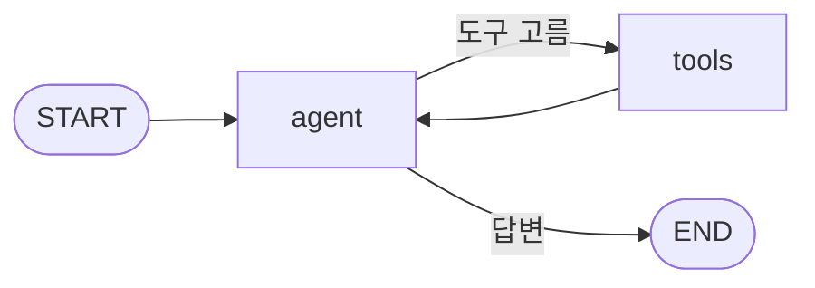
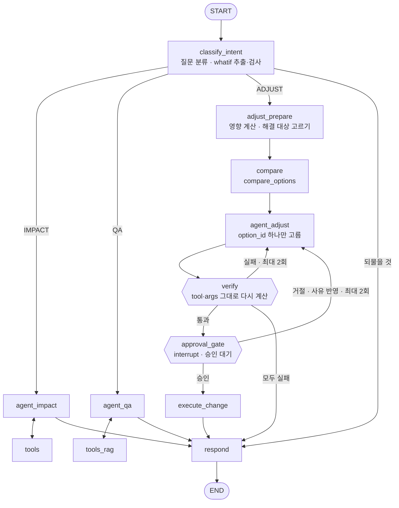

# `agent-draft` 브랜치 변경 사항

> **브랜치**: [`agent-draft`](https://github.com/skala2-bom/ai-agent-capstone/tree/agent-draft) · 커밋 `06168cb` (2026-10-20 16:25)
>
> **비교 기준**: `main`의 `7cea93e` ("Move SC golden answers into eval/golden.json") — 이 커밋에서 갈라졌다
>
> **범위**: C 파트(agent · business-mcp)만. 파일 11개, +1,327 / −239줄. **main에는 합치지 않았다** (PR 없음)
>
> **변경 내용 직접 보기**: https://github.com/skala2-bom/ai-agent-capstone/compare/7cea93e...agent-draft

---

## 1. 한 줄 요약

뼈대 수준(`agent ↔ tools` 반복 하나)이던 agent를 **아키텍처 5장의 그래프**로 바꿨다. 질문에서 가정 변경(whatif)을 뽑아 검사하고, 영향 분석 / 해결 방법 / 규정 질문으로 나뉘며, 해결 방법은 **검증 → 승인 대기(멈춤) → 승인 후 재개 → 실행**까지 이어진다. business-mcp는 도구 1개에서 **계약서의 1차 도구 8개**로 늘었다.

---

## 2. 바뀐 파일

| 파일 | 구분 | 변경량 | 무엇이 바뀌었나 |
|---|---|--:|---|
| `agent/graph.py` | 새 파일 | +657 | 그래프 전체 (노드·분기·반복·승인 대기), MCP 호출, 금액 2차 숨김, 진행 이벤트 |
| `agent/whatif.py` | 새 파일 | +217 | whatif 형식·검사, verify 판정, 키 없을 때 쓰는 규칙 분류 (순수 함수) |
| `agent/main.py` | 고침 | +146 / −210 | API(작업 실행 · **승인 후 재개** · health), checkpointer 연결, 120초 제한 |
| `agent/eval_golden.py` | 새 파일 | +66 | `eval/golden.json`으로 whatif 추출·verify 판정 평가 |
| `agent/prompts/*.md` | 새 파일 4개 | +89 | 지시문을 코드에서 파일로 분리 (classify · impact · adjust · qa) |
| `agent/Dockerfile` | 고침 | +5 / −2 | PostgreSQL checkpointer 패키지, 새 파일 복사 |
| `business-mcp/server.py` | 고침 | +141 / −26 | 도구 1개 → 8개, 오류 형식, 요청자 헤더 전달 |
| `docker-compose.yml` | 고침 | +6 / −1 | agent에 checkpointer DB 주소, postgres 기동 대기 |

---

## 3. 이전과 비교

### 3.1 그래프

**이전** — 노드 2개, 경로 1개



**이후** — 노드 12개, 분기 3갈래, 반복 2곳, 승인 대기 1곳 (아키텍처 5장)



| 항목 | 이전 | 이후 |
|---|---|---|
| 질문 분류 | 없음 (모든 질문이 같은 경로) | `classify_intent`가 IMPACT / ADJUST / QA로 분류 |
| whatif | 가짜 모델이 SC1 값을 코드에 박아 둠 | **질문에서 추출**하고 코드가 검사 (형식, 계획 존재, 질문의 원래 날짜와 고른 계획 일치). 틀리면 모델에게 한 번 더 기회 |
| 해결 방법 | 없음 | `compare_options` 후보 중 **option_id만** 모델이 고르고, 실행 인자는 코드가 후보에서 그대로 복사 |
| verify | 없음 | 고른 후보의 `tool`·`args`를 **그대로** whatif에 더해 다시 계산 → "대상 결품 해소 + 새 결품 없음"이면 통과 |
| 승인 | 없음 | 변경 도구 앞에서 `interrupt`로 멈춤 → 팀장 결정을 받아 재개 |
| 권한 | 없음 | ADJUST는 구매·팀장만. 생산관리 담당자가 요청하면 IMPACT로 답하고 "구매팀에 해결 요청" 안내 |

### 3.2 API (agent 서버)

| API | 이전 | 이후 |
|---|---|---|
| `POST /agent/tasks` | `taskId`, `question`만 읽음 | 계약 2.6 전부 받음: `taskId`, `threadId`, `userId`, `role`, `question`, `whatif` (모두 선택값이라 지금 backend와도 호환) |
| `POST /agent/tasks/{id}/resume` | 없음 | **새로 추가** (계약 2.7). `{threadId, approvalId, decision, reason}`. 사유 없는 거절은 422, 대기 중이 아니면 409 |
| `GET /health` | 없음 | 그래프 준비 여부, checkpointer 종류, 모델 종류 |

같은 `threadId`로 다시 부르면 앞 대화의 상태를 이어받는다. 예: 영향 분석 뒤 "해결 방법 찾아 줘"라고 하면 앞에서 뽑은 whatif를 그대로 쓴다.

### 3.3 진행 이벤트

| 이벤트 | 이전 | 이후 |
|---|---|---|
| `TOOL_START` | `tool` | `tool`, **`label`** (예: "영향 분석 중") |
| `TOOL_END` | `tool`, `ok`, `ms` | 같음 |
| `APPROVAL_REQUIRED` | 없음 | **새로 추가**: `tool`, `args`, `summary`, `amount`, `evidence`, `option_id`, `verify` |
| `DONE` | `status`, `answer`, `sources` | + **`result`**(whatif·영향·선택안·검증 기록·실행 결과), **`next_actions`**(예: 해결 방법 찾기 버튼) |
| `FAILED` | `errorCode`, `message` | + **`traceId`**. 오류 코드 구분: `TIMEOUT`, `LOOP_LIMIT`, `TOOL_UNAVAILABLE` 등 |

끝 이벤트(DONE · FAILED · APPROVAL_REQUIRED)는 실패하면 3번까지 다시 보낸다 (이전에는 한 번 실패하면 버림 → 화면이 계속 기다리는 문제).

### 3.4 business-mcp 도구

| 구분 | 이전 | 이후 |
|---|---|---|
| 조회 | – | `get_item`, `get_inventory`, `list_plans`, `list_receipts` |
| 계산 | `analyze_impact` | `analyze_impact`, `compare_options` |
| 변경 (승인 필요) | – | `request_due_date_change`, `split_po` — **`destructive_hint = true`** |
| 오류 | `[HTTP_상태] 원문` (연결 실패만 `UPSTREAM_TIMEOUT`) | 계약 2.5 형식 `[코드] 메시지 retry_hint` |
| 요청자 헤더 | 없음 | `X-Task-Id`·`X-User-Id`·`X-Role`·`X-Service-Token`을 해석하지 않고 backend로 그대로 전달 (계약 1.1) |

도구 설명(docstring)에 받는 값 · 돌려주는 값 · 단위(개 · 원 · YYYY-MM-DD)를 적었고, `analyze_impact`에는 whatif op 6개를 모두 적었다.

### 3.5 Harness 8요소

| 요소 | 이전 | 이후 |
|---|---|---|
| Instructions | 코드 안 문자열 하나 | `agent/prompts/*.md` 4개로 분리. 결과 칸 읽는 법 명시 (−100 = 100개 부족, `threshold`는 기준선, `orderable=false`는 "새 발주로는 늦음") |
| Tools | 도구 2개, 오류는 ToolMessage | 1차 8개 + 문서 읽기. 경로마다 쓸 수 있는 도구를 나눔 (영향 분석 경로에 변경 도구 없음) |
| Context | 없음 | 생산 계획 표(제품 이름 포함)를 지시문에 넣어 "허브" → PP-05를 찾게 함 |
| State · Memory | `MessagesState`, checkpointer 없음 | 필드 30여 개의 `AgentState` + **PostgreSQL checkpointer** (`agent` 스키마, 테이블은 LangGraph가 자동 생성) |
| Agent Loop | `recursion_limit=16` | 모델 호출 8회, 같은 도구 3회, **작업 120초**, 도구 1회 10초 |
| Guardrails | 지시문뿐 | whatif 코드 검사, `approval_gate`(interrupt), 실행 직전 `destructive_hint` 재확인, 금액 2차 숨김, ADJUST 권한 |
| Recovery | 예외 시 FAILED | + 모델 429·503 2회 재시도(`max_retries`), 대체 모델(`FALLBACK_MODEL` 설정 시), 끝 이벤트 재전송 |
| Observability | `TOOL_END`에 `ms` | + `traceId`, `TOOL_START`의 `label` |

### 3.6 앞선 코드 검토에서 나온 문제

| 문제 | 이전 | 이후 |
|---|---|---|
| 시간 제한이 없어 작업이 끝나지 않을 수 있음 | 있음 | 작업 120초 · 도구 10초 제한 |
| DONE 유실 시 화면이 결과를 못 받음 | 있음 | 끝 이벤트 3회 재시도 |
| 모델이 −100을 "재고 0개"로 읽음 | 있음 | 지시문에 칸 의미 명시. 시험에서 재발 없음 |
| `orderable=false`를 "주문 불가"로 설명 | 있음 | "새 발주로는 늦음 → 기존 발주 조정"으로 명시 |
| 없는 조항 주소를 지어내고, 그 **오류 문장이 근거로 저장됨** | 있음 | 읽을 수 있는 조항 목록을 지시문에 넣고, 성공한 읽기만 근거로 남김 |
| 승인 대상을 도구 이름으로만 알 수 있음 | 있음 | MCP `list_tools`의 `destructive_hint`로 판단 |
| 가짜 모델에서 도구 실패 시 원인이 가려짐 | 있음 | 그래프 구조 변경으로 해당 코드 없어짐 |

---

## 4. 검증 결과 (2026-10-20, 기준 커밋 `7cea93e`의 backend로 시험)

| 시험 | 결과 |
|---|---|
| `eval/golden.json` whatif 추출 (BASE · SC1~SC4) | ✅ 실제 모델(gpt-4o-mini) 2회 연속 5/5, 가짜 모델 5/5 |
| verify 판정 (`SC1-FIX-OK` 통과 · `SC1-FIX-FAIL` 실패 · `SC4-FIX-OK` 통과) | ✅ 3/3 |
| 영향 분석 — 화면 → backend → agent (SC1) | ✅ "스마트 플러그 연쇄 결품 100개" 등 숫자 정확 |
| 해결 요청 — 구매 담당자 (SC1) | ✅ OPT-1 → 검증 통과 → **승인 대기** → 거절하면 OPT-2 재제안 → 승인하면 발주 변경 실행 |
| 재개 API 예외 | ✅ 사유 없는 거절 422, 끝난 작업 재개 409 |
| 해결 요청 — 생산관리 담당자 | ✅ 권한이 없어 영향 분석으로 답하고 `next_actions: 구매팀에 해결 요청` |
| 해결 요청 — SC4 (당시 `compare_options`가 SC1 고정 응답) | ✅ verify가 두 후보를 모두 걸러 "통과한 해결안 없음" |
| business-mcp 정지 장애 | ✅ 즉시 `FAILED (TOOL_UNAVAILABLE)` |
| checkpointer | ✅ `agent` 스키마에 테이블 4개 생성, agent 계정은 업무 테이블 접근 불가 |

작업 중 발견해 고친 것
- 모델이 SC2에서 같은 제품의 다른 날짜 계획(PP-01)을 고름 → "질문에 적힌 원래 생산일과 고른 계획이 맞는지" 코드 검사 추가
- OpenAI 구조화 출력의 기본 방식(`json_schema`)이 날짜 뒤에 JSON 조각을 섞음 (`"2026-11-25}],"`) → `function_calling` 방식으로 변경

---

## 5. 실행 방법

```bash
git switch agent-draft
docker compose up -d --build
```

평가 (compose가 떠 있을 때):

```bash
docker compose cp eval/golden.json agent:/tmp/golden.json
docker compose exec agent python eval_golden.py /tmp/golden.json                      # 실제 모델 (비용 발생)
docker compose exec -e OPENAI_API_KEY= agent python eval_golden.py /tmp/golden.json   # 가짜 모델 (비용 없음)
```

- `OPENAI_API_KEY`가 없으면 규칙 분류(가짜 모델)로 전체 흐름이 돈다.
- checkpointer 테이블은 처음 실행할 때 자동으로 생긴다. `docker compose down -v`를 하면 DB와 함께 지워진다.

---

## 6. 알려진 한계 · 팀 확인 필요

### 6.1 이 브랜치 이후 main에 들어온 변경과 맞춰야 할 것

`agent-draft`를 올린 뒤 main에 `e4aa81b`(compare_options 실제 계산), `9185127`(로그인 · 역할별 금액 숨김)이 들어왔다. **파일 충돌은 없다.** 다만 아래는 코드 수정이 필요하다.

| # | 내용 | 할 일 |
|:-:|---|---|
| 1 | `compare_options` 요청에 **`whatif`가 추가됨** (계약 2.3). 지금 코드는 `issues`만 보내서 가정 질문에서 후보가 0개가 될 수 있음 | `compare` 노드가 `{"whatif", "issues"}`로 보내기 |
| 2 | 결품 부품이 여럿이면 **추천안도 여럿** (SC2: 릴레이 · 전원 모듈). 지금은 후보 하나로 "모든 결품 해소"를 검증해서 SC2가 항상 실패 | 부품별로 고르고 검증, 승인 요청도 후보마다 따로 |
| 3 | 후보에 `resolves`·`side_effects`·`recommended`·`cost_level`이 생김 | 고르는 기준·지시문에 반영 (verify는 이중 확인으로 유지) |
| 4 | backend가 `userId`·`role`을 agent에 보내기 시작함 | 화면에서도 ADJUST가 열림. 권한 흐름 다시 시험 |

### 6.2 설계 · 계약 확인

| # | 내용 |
|:-:|---|
| 1 | **노드 이름이 아키텍처 5장과 다름**: `tools_adjust` 대신 `adjust_prepare` + `compare`. 문서를 고치거나 이름을 맞춰야 함 (결정 6.11 "설계도와 코드 1:1") |
| 2 | **가정 질문에 대한 발주 변경이 실제로 실행됨.** 일정은 그대로인데 발주만 당겨질 수 있음. "일정이 실제로 바뀐 뒤에만 실행" 같은 규칙 필요 |
| 3 | verify "최대 2회 재시도"를 **첫 시도 + 재시도 2회**로 구현 |
| 4 | 안전재고 경고는 verify 통과를 막지 않음 (결과에는 남김) |
| 5 | `orderable=true` 결품은 해결 대상에서 뺌 (새 발주 도구 없음, 결정 6.16과 같은 방향) |
| 6 | `DONE`에 `next_actions` 칸 추가 (계약상 칸 추가는 허용). 화면이 써야 버튼이 보임 |
| 7 | 역할을 모르면 가장 좁은 권한(생산관리)으로 봄 |

### 6.3 아직 없는 것

- backend 쪽: 승인 API와 승인 기록, 팀장 결정 후 `/resume` 호출, `APPROVAL_REQUIRED`에 승인 번호 붙이기, 승인 대기 중 SSE 유지(지금 120초)
- 규정 질문: rag-mcp `search_docs` 없음. 읽을 수 있는 조항 1개뿐이고 내용이 기획안의 ECN과 다름
- 대체 모델은 같은 OpenAI만 지원 (결정 6.11은 제공자를 다르게 두라고 함)
- 2차 도구 5개 (`explode_bom`, `where_used`, `get_supplier_metrics`, `change_po_qty`, `cancel_po`)
- LangSmith 추적, `TOKEN` 스트리밍
