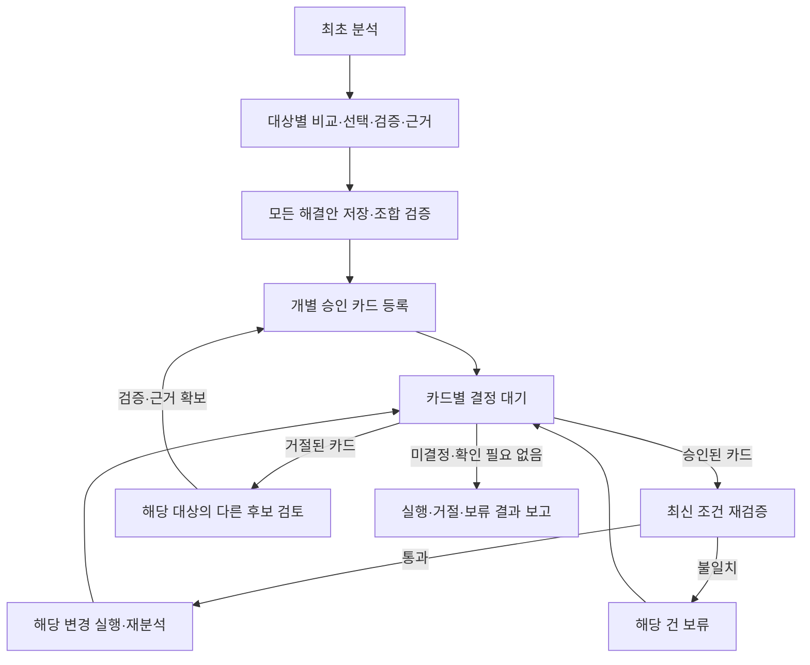
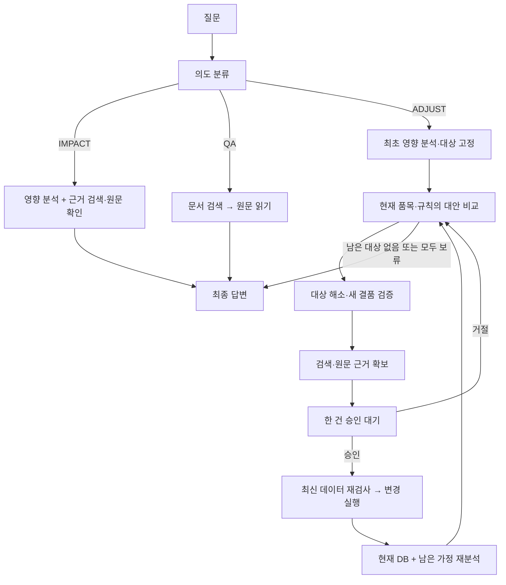

# AI·MCP·RAG 수정 및 검증 기록

## 2026-10-21 — 여러 품목의 승인 전 준비와 개별 실행

기준 커밋 `8867953`, 로컬 `rag` 브랜치. 사용자가 요청한 구현·테스트이며 커밋·푸시는 하지 않았다.
backend·업무 DB 정의·business-mcp·rag-mcp·기본 Compose·`.env`는 변경하지 않았다.
AI 전용 `agent` 스키마에만 접수·승인 연결·실행 기록·진행 발행함을 추가한다.
거절 의견으로 “100개를 최소 200개로” 같은 새 수량 후보를 만드는 기능은 보류했다.

### 동작

1. 최초 분석의 품목·규칙 범위를 고정하고, 각 안을 현재 DB + 사용자 가정으로 독립 검증한다. 미승인 안을 실행된 것으로 가정하지 않는다.
2. 근거 확인까지 끝난 안들을 체크포인트에 모으고 조합 검증한다. 같은 발주를 동시에 바꾸는 후보는 제외한다.
3. 기존 승인 API로 개별 카드들을 등록한다. SC2는 3건, SC3은 2건을 사람 승인 전에 준비한다.
4. 팀장은 카드마다 승인/거절할 수 있다. 승인된 건은 최신 조건 재검증 후 실행하고, 다른 미결정 건은 기다린다. 같은 작업의 DB 변경은 하나씩 처리한다.
5. 거절된 대상은 기존 계산 서비스의 미시도 후보로만 다시 제안한다. 이전 제안·승인은 보존하고 새 revision/승인을 연결한다.
6. 미결정·등록 불명·실행 불명인 건이 없어야 완료한다. `DONE.result` 기본 3칸은 그대로이며 `proposals`, `approval_summary`를 추가한다.



### 변경 파일

| 파일 | 이번 수정 |
|---|---|
| `agent/graph.py` | proposal별 상태·revision, 전 대상 사전 준비, 조합 검증, 카드 ID별 재개, 개별 실행 보류, 재제안 범위 제한, 실행 직전 검증, 성공 응답 복구 |
| `agent/main.py` | 시작/결정을 영구 저장한 뒤 202, 중복 접수, 구형 체크포인트 거부, DB 없는 메모리 접수 중단 |
| `agent/approval_store.py` **추가** | PostgreSQL 영구 접수함·thread 잠금·카드 연결·실행 journal·진행 outbox |
| `agent/approval_runner.py` **추가** | 저장된 명령 처리, 승인 우선 처리, 등록 중 들어온 결정 보존, 재시작 재개, 응답 불명 시 중복 방지 |
| `agent/sql/001_approval_workflow.sql` **추가** | agent 계정 소유 4개 테이블. 업무 테이블 수정 없음 |
| `agent/Dockerfile`, `agent/prompts/adjust.md` | SQL 포함, 승인 전 다건 준비와 기존 후보만 재선택하도록 지침 수정 |
| `frontend/src/views/Approvals.vue` | 작업별 그룹, 카드별 결정, 최신 선택 카드, 목록만 3초 갱신, 취소/감량 표시, 실제 문서 근거 |
| `frontend/src/components/AiPanel.vue`, `frontend/src/views/History.vue` | 기존 작업 재조회/재구독, 카드별 진행·보류 표시, 팀장의 타인 작업 완료 결과 조회, QA 빈 영향 결과 숨김, ADJUST 실행 후 영향 표시 |
| `frontend/src/services/api.ts`, `sse.ts`, `stores/workspace.ts`, `types.ts` | 승인 전용 조회/결정, 개별 busy, 오래된 조회·로그아웃 응답 차단, 추가 이벤트 중복/순서 처리 |
| `tests/test_approval_runner.py` **추가** | 영구 접수·개별 처리·중단 복구·응답 불명·중복·잠금·HTTP 접수 회귀 검사 |
| `tests/integration_scenarios.py`, `tests/compose.yml` | 승인 전 카드 수·역순/부분/동시 결정·재시작 검사, 별도 agent 단위 테스트 DB |
| `frontend/tests/approvals.test.ts` **추가**, `api.test.ts`, `sse.test.ts` | 동시 결정·오래된 응답·중복 이벤트·취소/감량/근거 검사 |
| `README.md`, `docs/contracts.md`, `docs/decisions.md`, `tests/README.md`, 이 문서 | 변경 계약·선택 이유·재현 명령·검증 범위 |

### 검증

- 실제 backend·RabbitMQ·MCP·PostgreSQL을 사용하는 격리 프로젝트 `capstone-ai-test`에서 수행했다. 개발 업무 데이터는 초기화하지 않았다.
- **가짜 모델 및 실제 모델 각각**: 골든 데이터 8문항, SC1~4 분석/승인/실행, 거절 후 재승인, 3건 사전 등록 후 부분/동시 승인·거절, 중복 resume, SYSTEM 자동 분석, 문서 QA 통과.
- **실제 컨테이너 재시작**: 3건 승인 대기 상태에서 테스트 AI를 재시작하고, 기존 카드 3개만 승인·실행되는 것을 확인했다.
- AI/RAG 기존 회귀 18개 및 별도 승인 복구 검사 12개, 프론트 테스트 33개, TypeScript/Vite 빌드 통과. 재현 명령은 [tests/README.md](../tests/README.md).
- 검증 후 테스트 컨테이너만 중지했다. 테스트 볼륨·기록은 보존하고 개발 서비스는 재시작하지 않았다.
- 프론트 상태/API 로직은 자동 테스트했으며 실제 브라우저에서 역할을 바꿔 클릭하는 수동 시연은 별도로 필요하다.

### 로컬 화면에서 확인하기

구형 단일 승인 그래프로 대기 중인 작업은 기존 버전에서 먼저 마무리한다. 업무 DB를 삭제해서 전환할 필요는 없다.
준비가 끝난 환경에서 저장소 루트에서 AI·프론트만 재빌드한다. 이번 작업에서 개발 서비스는 재시작하지 않았다.

```bash
env -u OPENAI_API_KEY -u OPENAI_MODEL docker compose --env-file .env up -d --build --no-deps agent frontend
```

1. 구매 계정 `buyer`로 SC2 질문: **“스위치 11/23 생산 수량을 600개에서 900개로 늘리고 플러그 11/30 생산 수량을 800개에서 500개로 줄이면 문제 있어? 결품과 과잉 해결 방법 만들어 줘.”**
2. 팀장 `approver`의 승인 대기함에서 같은 작업에 **전원 모듈 분할·릴레이 분할·플러그 케이스 감량 3건**이 함께 준비되는지 확인한다.
3. 하나만 승인한다. 다른 두 건을 미결정으로 두어도 승인한 건이 `실행 완료`로 갱신되는지 확인한다.
4. 나머지 중 하나는 승인하고 다른 하나는 “분할 대신 다른 대안 요청”으로 거절한다. 거절된 대상만 새 카드가 생기는지 확인한다. 원래 거절 건은 남아야 한다.
5. 구매 계정의 작업 이력 → **현재 작업 · 승인 진행과 결과 보기**에서 기존 작업을 연다. 새 분석을 만들지 않고 진행을 이어 보는지 확인한다.
6. 전부 처리한 뒤 발주·변경 이력, 실행/거절/보류 결과, 실행 후 남은 문제를 확인한다.

### 남는 한계와 복구 경계

- backend 승인 상태는 4개 그대로다. AI 재검증에서 보류돼도 팀장 승인 카드 자체는 `APPROVED`일 수 있다. 요청자는 실시간 제안 상태를, 팀장은 작업의 완료 결과를 확인한다. 다른 사람 작업의 SSE 권한은 확대하지 않았다.
- backend의 등록 중복 제거는 PENDING만 지원한다. 등록 응답이 끊겼다면 자동 재등록하지 않고 `REGISTRATION_UNKNOWN`으로 보류한다. 해당 작업/도구/인자의 기존 카드를 먼저 대조해야 한다.
- 실행 성공 응답이 journal에 저장됐으면 체크포인트 재개에서 재사용한다. 실행 응답을 확정하지 못했으면 `EXECUTION_UNKNOWN`으로 보류하고 같은 승인을 자동 재실행하지 않는다. 발주/변경 이력/승인 상태를 대조하는 운영 복구는 자동화하지 않았다.
- 등록/실행 불명 상태가 있어도 연결이 정상인 다른 카드는 처리하지만 전체 작업을 완료로 표시하지 않는다. 예상 밖의 처리 오류/시간 초과는 접수함 `HELD`와 확인 안내를 남긴다. 자동 재시도로 업무 변경을 추측하지 않는다.
- backend가 메시지 전달 실패로 전체 작업을 `FAILED` 처리하거나 재검증과 실제 변경 사이에 다른 작업이 DB를 바꾸는 경쟁 조건은 이번 AI·프론트 변경만으로 해결하지 않는다.

---

## 2026-10-20 — 이전 AI·MCP·RAG 통합 기록

기준: `fc60a88`에서 구현한 AI·MCP·RAG 작업에 `origin/main`의 `11f728e`(RabbitMQ 작업 대기열)를 merge한 `rag` 브랜치.
사용자가 AI·MCP·RAG 구현을 승인한 범위의 변경이다. 프론트·백엔드 업무 코드는 수정하지 않았다.

## 무엇이 달라졌는가

1. **실제 RAG**: 제공 문서 6개를 조항 단위로 색인하고 `search_docs`로 검색한다. 기존 “허브 MCU 교체” 하드코딩은 삭제했다. 검색한 URI의 원문을 실제로 읽고 버전·조항·출처를 답변과 승인 카드에 붙인다.
2. **과잉 승인·실행**: `INV-003`의 감량, 취소, 입고 연기도 `INV-001` 결품 해결과 같은 검증·승인 흐름을 거친다.
3. **여러 품목의 해결**: 한 품목·규칙씩 비교 → 검증 → 근거 → 승인 → 실행 → 재분석한다. 다음 변경에는 별도 승인이 필요하다. 최초 분석의 대상 범위 밖으로 자동 확대하지 않는다.
4. **실행 전 재검사**: 승인 대기 후 최신 후보·비용·위험·부작용을 재확인한다. 조건이 바뀌면 기존 승인으로 실행하지 않는다.
5. **결과 계약 유지**: `DONE.result.intent`, `whatif`, `impact`를 유지한다. 여러 실행 내역과 실행 후 결과는 별도 필드다.



검증 실패·거절에는 재시도 한도가 있고, 근거 검색 실패는 해당 대상의 승인 요청을 보류한다.
실행 도구가 실패하면 같은 변경을 자동 재실행하지 않는다.

## 수정한 파일

| 파일                                                                    | 수정 내용                                                                                                                                                                                                                            |
| ----------------------------------------------------------------------- | ------------------------------------------------------------------------------------------------------------------------------------------------------------------------------------------------------------------------------------ |
| `agent/graph.py`                                                      | `search_docs` 연결, 실제 원문 출처 검증, QA 검색→읽기, 영향 분석 근거 첨부. 결품·과잉별 선택/검증/승인/실행 반복. 승인 후 재검증, 남은 문제·부작용·실행 결과 설명, 역할별 `saved_amount` 마스킹                              |
| `agent/whatif.py`                                                     | `INV-001` 긴급 결품 + `INV-003` 과잉 대상화. 품목·규칙별 검증, 새로 생기거나 악화한 결품 차단. 재계산 때 바뀌는 `option_id` 대신 tool+args로 거절 대안 추적. 실행한 변경 중복 적용 방지. 긴 질문의 명시적 해결 요청 분류 보완 |
| `agent/main.py`                                                       | 새 작업의 검색/실행/현재 분석 상태를 초기화해 같은 thread의 이전 결과 혼입 방지                                                                                                                                                      |
| `agent/prompts/qa.md`                                                 | 고정 조항 목록 삭제. 검색 결과 URI의 원문을 읽고 답하도록 변경                                                                                                                                                                       |
| `agent/prompts/classify.md`                                           | 영향 질문과 해결 요청이 함께 있으면 ADJUST 우선, 의도 선택 이유를 unclear에 넣지 않도록 명시                                                                                                                                         |
| `agent/prompts/impact.md`                                             | 실제 검색·원문 확인을 마친 근거를 모델 문맥에 전달                                                                                                                                                                                  |
| `agent/prompts/adjust.md`                                             | 결품/과잉 구분, 현재 대상만 선택, `side_effects`·`remaining_issues` 해석                                                                                                                                                        |
| `business-mcp/server.py`                                              | 이미 등록된 도구 13개와 서비스 토큰 교체를 설명에 반영. 감량·취소·target_rule 등 최신 대안 계약 설명 보완. backend 호출 경로/토큰 로직은 유지                                                                                      |
| `rag-mcp/server.py`                                                   | 하드코딩 Resource 제거. 실제 DB 기반 `search_docs`, 조항/문서 전체 Resource                                                                                                                                                        |
| `rag-mcp/documents.py` **신규**                                 | 문서 manifest·해시·경로·종류·시행일 검증, `## x.y` 조항 청킹                                                                                                                                                                   |
| `rag-mcp/embeddings.py` **신규**                                | 실제 OpenAI 임베딩, 모델·차원 고정, 벡터 형식 검사, 짧은 일시 오류 재시도. 키/오류 응답 본문 로그 배제                                                                                                                              |
| `rag-mcp/docstore.py` **신규**                                  | rag 계정의 원자적 증분 색인·삭제·메타데이터 갱신, 코사인 검색, 원문 조회, 모델 불일치 차단                                                                                                                                         |
| `rag-mcp/sql/001_documents.sql` **신규**                        | `rag.document`, `rag.doc_chunk`, `rag.index_meta` 생성                                                                                                                                                                         |
| `rag-mcp/indexer.py` **신규**                                   | 수동 색인 CLI와 외부 호출 없는 `--check`                                                                                                                                                                                           |
| `rag-mcp/requirements.txt` **신규**                             | RAG 의존성 버전 고정                                                                                                                                                                                                                 |
| `rag-mcp/Dockerfile`                                                  | 새 RAG 모듈·SQL·의존성 포함                                                                                                                                                                                                        |
| `docker-compose.yml`                                                  | RAG DB/임베딩 설정, 수동 `rag-index` 프로필, postgres 준비 대기                                                                                                                                                                    |
| `.env.example`                                                        | 임베딩 모델·차원 예시 추가. 실제 `.env`는 변경하지 않음                                                                                                                                                                           |
| `tests/test_ai_rag.py` **신규**                                 | 판정·승인 보호·문서 출처·실제 pgvector 회귀 검사                                                                                                                                                                                  |
| `tests/integration_scenarios.py` **신규**                       | 테스트 DB 초기화, SC1~4 실제 API/MCP/승인/실행/SSE 검사, 거절·SYSTEM·QA                                                                                                                                                            |
| `tests/rag_fixture.py`, `tests/serve_rag_fixture.py` **신규** | 외부 API 없는 테스트 전용 벡터 및 서버 실행기                                                                                                                                                                                        |
| `tests/compose.yml`, `tests/compose.real.yml` **신규**        | 기존 개발 환경과 분리된 가짜/실제 모델 테스트 환경                                                                                                                                                                                   |
| `tests/README.md` **신규**                                      | 재현 명령, 실제 모델 전송 범위·비용, 테스트 환경 정리 방법                                                                                                                                                                          |
| `data/README.md`                                                      | 색인·재색인 명령, 저장/검색 계약, 정책 문서의 금액 기준 확인 사항                                                                                                                                                                   |
| `docs/contracts.md`                                                   | 변경 30번과 ADJUST 추가 필드·순차 승인 의미 명시                                                                                                                                                                                    |
| `README.md`                                                           | 실제 RAG/승인 흐름·설정·실행 안내 갱신                                                                                                                                                                                             |
| 이 파일 **신규**                                                  | 수정 목록·검증 결과·팀 후속 작업                                                                                                                                                                                                   |

## 시나리오별 동작

각 질문은 **새 시드**에서 구매 계정으로 입력한다. 프론트에서 입력할 때는 AI 질문창을 사용한다.
승인은 팀장 계정에서 카드마다 한 번씩 해야 한다. 자동 테스트는 격리 DB의 테스트 계정으로만 승인한다.

| 시나리오 | 질문 예시                                                                                              | 승인·실행 기대값                                                                                          | 최종 확인                                                                              |
| -------- | ------------------------------------------------------------------------------------------------------ | ---------------------------------------------------------------------------------------------------------- | -------------------------------------------------------------------------------------- |
| SC1      | 허브를 11/25로 당기면 부족한 MCU 해결 방법 만들어 줘                                                   | `PO-2609-001`에서 100개 분할, 11/25 입고                                                                 | 허브·플러그 긴급 결품 해소, 안전재고 경고는 남음                                      |
| SC2      | 11/23 스위치 생산을 900대로 늘리고 11/30 플러그 생산은 500대로 줄일 때 결품과 과잉 해결 방법 만들어 줘 | 전원 모듈 `PO-2610-113` 200개 분할, 릴레이 `PO-2610-114` 400개 분할, 케이스 `PO-2610-115` 800→500개 | 승인 3건. 긴급 결품·플러그 케이스 과잉 해소. 새 발주 가능한 결품은 안내로 남음        |
| SC3      | 도어센서 11/18 생산을 1/4로 미루면 결품과 과잉 해결 방법 만들어 줘                                     | 옛 케이스 `PO-2610-110` 취소, 코인전지 `PO-2610-103` 입고 2027-01-04로 연기                            | 승인 2건. 코인전지 취소는 새 결품을 만들므로 실행하지 않음. 새 케이스 발주 필요는 남음 |
| SC4      | PO-2610-106 입고가 11/27로 늦어지면 부족한 릴레이 해결 방법 만들어 줘                                  | 해당 발주에서 1,000개 분할, 11/23 입고                                                                     | 긴급 결품 해소. 협력사 지연 입력 API의 자동 분석은 SYSTEM/PLANNER로도 별도 확인        |

**가정과 실행의 구분**: 질문의 생산계획 변경은 분석 가정이며 자동 저장하지 않는다.
승인한 발주 변경은 실제 DB에 저장된다. `post_execution_impact`는 현재 DB에 `remaining_whatif`를 함께 적용한 결과다.
실제 화면 전체를 같은 상태로 만들려면 생산관리 담당자가 계획 변경을 별도로 저장해야 한다.

## 최신 main 병합

`11f728e`의 RabbitMQ 변경을 merge로 반영했다. backend 구현과 테스트는 main의 내용을 그대로 유지했다.
AI·MCP·RAG 코드와 원문 문서는 병합 전 구현에서 바뀌지 않았다.

- `README.md`: 서비스 수를 7개로 맞추고, 작업 접수·승인 재개가 RabbitMQ → backend 소비자 → agent HTTP 호출을 거치는 흐름을 설명했다.
- `docker-compose.yml`: main의 RabbitMQ 설정·볼륨·backend 연결과 AI 파트의 RAG 환경변수·수동 `rag-index`를 모두 유지했다.
- `docs/contracts.md`: backend 대기열 변경은 29번, AI·RAG 변경은 30번으로 구분하고 참조 번호를 맞췄다.
- `tests/compose.yml`, `tests/README.md`: 독립 테스트 환경에도 RabbitMQ와 전용 볼륨을 추가했다.

## 검증 결과

검증 환경: 호스트 포트 없는 `capstone-ai-test` 프로젝트, 별도 `capstone_ai_test` DB.
기존 `ai-agent-capstone` 컨테이너·볼륨은 재시작하거나 변경하지 않았다.

| 검사                                           | 결과                                                                    |
| ---------------------------------------------- | ----------------------------------------------------------------------- |
| Python 문법/import, `git diff --check`       | 통과                                                                    |
| 단위 + 실제 pgvector 회귀                      | 18개 통과                                                               |
| 시드 기준 골든셋 숫자/대안 비교                | 8개 통과                                                                |
| 가짜 모델 SC1~4 끝까지                         | 통과 — 실제 backend/MCP/승인 API/DB/SSE 사용                           |
| 가짜 모델 거절 후 재제안, SYSTEM 자동 분석, QA | 통과                                                                    |
| 실제 임베딩 문서 6개·조항 31개 색인           | 통과 (`text-embedding-3-small`, 1536차원)                             |
| 실제 `gpt-4o-mini` 평가                      | 의도/whatif 5개 + verify 3개 통과                                       |
| 실제 모델 SC1~4 승인·실행                     | 통과 — SC1 1건, SC2 3건, SC3 2건, SC4 1건 개별 승인·실행              |
| 실제 모델 거절·SYSTEM·문서 QA                | 통과. QA는 ECN 1.1·3.1 원문으로 케이스 변경이며 MCU 교체가 아님을 답변 |

위 실제 모델 검사는 RabbitMQ 병합 전 AI 구현의 결과다. 병합 후에는 외부 모델 호출 없이 실제 대기열 연결을 검사했다.

| RabbitMQ 병합 후 검사 | 결과 |
|---|---|
| backend `mvn -q test` | 25개 통과, 실패·오류·건너뜀 0개 |
| AI·RAG 단위 + 실제 pgvector 회귀 | 18개 통과 |
| 골든셋 숫자/대안 | 8개 통과 |
| 실제 RabbitMQ 경유 SC1~4 분석·개별 승인·실행·DB 이력·SSE | 모두 통과 (모델·임베딩은 테스트 대역) |
| 실제 RabbitMQ 경유 거절 후 재제안·SYSTEM 자동 분석·문서 QA | 모두 통과 |
| 기본/테스트 Compose 설정, Python 문법, `git diff --check` | 통과 |

backend는 `11f728e`와 동일하고, AI·MCP·RAG·프론트·원문 문서는 병합 전 `4096a35`와 동일함을 확인했다.

실제 모델 호출은 사용자가 문서 6개와 데모 시나리오 데이터를 `api.openai.com`에 보내는 것과 비용을 명시적으로 허용한 뒤 진행했다.
운영 DB에 색인하거나 운영 서비스로 배포하지 않았다. 재현 명령은 [tests/README.md](../tests/README.md).
검증 완료 후 이번에 만든 `capstone-ai-test` 컨테이너·네트워크·테스트 볼륨을 제거했다.

실제 모델 검사 중 SC2의 긴 질문 끝에 붙인 “해결 방법 만들어 줘”를 IMPACT로 잘못 분류한 사례를 발견했다.
이처럼 명시적 해결 요청이 있는데 IMPACT를 반환하면 ADJUST로 보완하되, 추출한 가정 검증·역할 제한·팀장 승인은 그대로 적용하도록 수정했다.
해당 사례의 회귀 테스트도 추가했다.
SC3에서는 의도 선택 이유를 `unclear`에 넣는 사례도 발견해, 계획·날짜·수량의 실제 모호성과 분리하도록 지침 및 재검사를 보완했다.

## 다른 팀에 전달할 사항 / 남은 한계

1. **프론트 승인 카드 — 시연 전에 수정 필요**
   `frontend/src/services/api.ts`의 `toApprovals()`는 `split_po`가 아니면 모두 `due-date`로 변환한다.
   `change_po_qty`는 새 수량, `cancel_po`는 상태 전환을 표시하도록 `tool`별 분기가 필요하다.
   현재 `date: String(args.new_due_date)` 때문에 감량·취소는 `"undefined"` 날짜가 될 수 있다.
   `confirmed: true`, `review: "확정"`도 협력사 확약의 근거로 쓰면 안 된다.
   이번에는 프론트를 수정하지 않았으며 브라우저 클릭 시연 완료로 보고하지 않는다.
2. **프론트 순차 승인 갱신**
   하나의 작업에 새 승인 카드가 여러 번 생긴다. 첫 승인 후 다음 카드가 보이도록 대기함 재조회/이벤트 처리를 확인해야 한다.
   완료 화면이 실행 후 잔여 문제를 보여 주려면 `post_execution_impact`를 사용한다.
   기존 `result.impact`는 최초 분석이므로 실행 뒤에도 초기 문제를 표시할 수 있다.
3. **선택 대안과 AI 요청**
   프론트의 “승인 요청”은 선택한 tool/args 전달이 아닌 “현재 계획 기준 … 해결 방법” 질문을 만든다.
   이번 agent는 해당 분석의 긴급 결품·과잉을 품목별로 처리하므로, 특정 카드 한 건만 승인 요청한다는 화면 설명과 차이가 있다.
   정확한 선택 대안 지정 계약은 A·B·C 협의가 필요하다.
4. **협력사 확약**
   제공 문서는 “협의/확약 후 가능” 조건이다. 시스템에는 협의 완료를 검증할 별도 필드가 없다.
   승인 문구에 확인을 요청하지만, 이것이 공급사 실제 확약을 자동으로 검증한 것은 아니다.
5. **동시 변경**
   agent가 승인 직후 다시 계산해도 재검사와 backend 변경 트랜잭션 사이의 경쟁 조건까지 원자적으로 막지는 못한다.
   실제 다중 사용자 환경에서는 backend의 상태 버전/잠금과 분석·변경의 일관성 계약이 추가로 필요하다.
6. **문서 금액 범위**
   `POL-COST-EVAL/2.2`의 30만/100만 원 등급 기준은 현재 모든 역할에 검색될 수 있다.
   실제 발주 원가와 구분되는 공개 기준인지 문서 담당자의 확인이 필요하다. 원문·해시는 임의 수정하지 않았다.
7. **배포 전 대기 작업**
   이번 그래프는 새 상태 필드를 사용한다. 이전 버전에서 이미 승인 대기 중인 작업은 그대로 재개하기보다 기존 버전에서 마치거나 새 분석으로 다시 요청하는 것이 필요하다.
8. **검색 평가 범위**
   기본 코사인 검색·문서 유형 필터와 시나리오 근거를 확인한다. 무관한 질의의 적합도 임계값이나 대규모 검색 품질 평가는 별도다.
9. **QA 아래 빈 영향 결과 표시**
   `frontend/src/components/AiPanel.vue`는 `result` 객체가 있으면 항상 `ServerResult`를 표시한다.
   문서 QA의 `{intent: "QA", impact: null}`도 통과해 빈 영향 결과·정책 버전 미제공·해결안 버튼이 나온다.
   `impact`가 실제로 있는 응답에만 영향 결과를 표시하도록 A 파트에서 조건을 바꿔야 한다. 이번 AI 변경에서는 수정하지 않았다.

새로 필요한 로컬 작업은 backend·RAG 이미지 재빌드, RabbitMQ 기동과 **rag 스키마 색인**이다. 이 변경 적용 때문에 업무 DB 전체를 `down -v`로 지울 필요는 없다.
